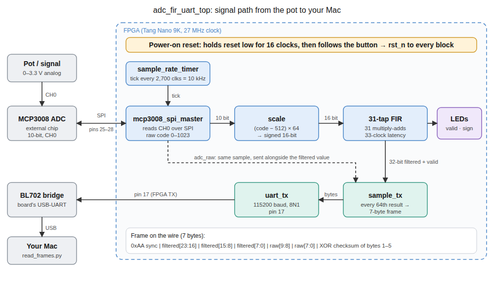
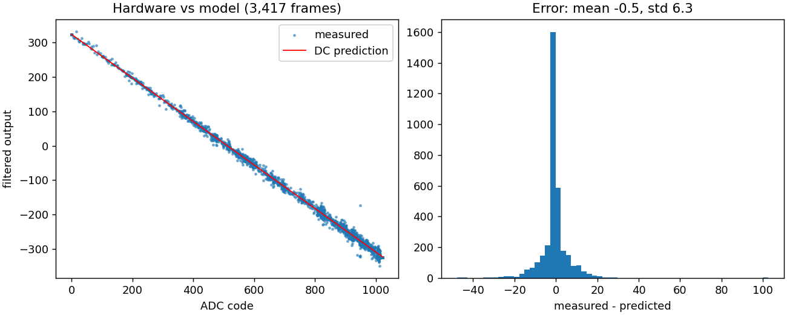

# FPGA Real-Time Signal Pipeline (Tang Nano 9K)

A real-time signal-processing pipeline on a Sipeed Tang Nano 9K (Gowin GW1NR-9C), built with the open-source toolchain (Yosys, nextpnr-himbaechel, Apicula, openFPGALoader):

```
analog input -> MCP3008 ADC (SPI) -> scale -> 31-tap FIR -> frame serializer -> UART -> host
```



## Status

| Stage | State |
|---|---|
| MCP3008 SPI master (CH0, single-ended, 10-bit, ~964 kHz SCLK) | Verified in simulation and on hardware |
| 31-tap time-multiplexed FIR (1 multiplier), triggered per sample, 33-cycle latency | Verified in simulation and on hardware (DC response) |
| Frame serializer + UART TX (115200 8N1) | Verified in simulation and on hardware |
| Host reader (`host/read_frames.py`) | Working |
| AC frequency-response measurement | Not done yet |
| FFT + threshold detector | Not started |

### Hardware check

A full pot sweep (3,417 frames, ADC codes 0-1023) compared against the DC gain of the filter (sum of coefficients = -324, Q15):



- Measured minus predicted: mean -0.5, std 6.3 (the spread is consistent with about half an ADC code of input noise through the filter's noise gain of 0.31).
- Output sign correct for every frame.
- Frame rate about 157/s against 156.25 expected (10 kHz / 64).
- 8 bytes discarded while resyncing out of about 24 kB.

### Simulation and implementation results

- Latency: 33 cycles (1.22 us) in the filter, 524 cycles (19.4 us) from ADC chip-select to filtered output, at 27 MHz. Each confirmed by a Python cycle-accurate model and by Icarus Verilog edge counting.
- Timing: 185.43 MHz achievable post-route against a 27 MHz clock (about 6.9x margin). Measured on the debug-wrapper build.
- Resources (debug-wrapper build): 154 LUT4, 1 MULT18X18, about 430 flip-flops.

## Design notes

- **Sample rate:** a timer divides the 27 MHz clock to 10 kHz and triggers each SPI conversion.
- **Scaling:** `(code - 512) << 6` centers the unsigned 10-bit code on zero and fills the 16-bit signed range.
- **FIR:** time-multiplexed, so one multiplier does one multiply-accumulate per clock over 31 taps. Q15 coefficients, output scaled back by 2^15. The filter runs one pass per new ADC sample (triggered), not free-running, because the ADC delivers a sample every 2,700 clocks.
- **Decimation:** only every 64th filtered result is sent, so the UART (about 11.5 kB/s at 115200) is not saturated. The filter itself still sees all 10,000 samples/s.
- **Frame (7 bytes):** `0xAA` sync, 24-bit signed filtered value, 10-bit raw code (2 bytes), XOR checksum of bytes 1-5. The host resyncs on `0xAA` plus a valid checksum.
- **Verification approach:** cycle-accurate Python models (`model/`) predict the simulation output; the testbenches (`tb/`) are checked against them; the hardware is then checked against the model.

## Repository layout

```
rtl/           synthesizable Verilog
constraints/   pin constraints (.cst)
tb/            testbenches
model/         Python reference models
host/          host-side reader
debug/         UART bring-up designs (kept as a record)
docs/          diagrams, plots, bring-up notes
build.sh       synthesize, place-and-route, pack, flash
```

## Build and flash

Requires the [OSS CAD Suite](https://github.com/YosysHQ/oss-cad-suite-build).

```bash
./build.sh            # build and flash adc_fir_uart_top
python3 host/read_frames.py /dev/cu.usbserial-XXXX --seconds 15 --csv sweep.csv
```

## Wiring (MCP3008 to Tang Nano 9K)

| MCP3008 | Signal | FPGA pin |
|---|---|---|
| 13 | CLK | 25 |
| 10 | CS/SHDN | 26 |
| 11 | DIN | 27 |
| 12 | DOUT | 28 |
| 16, 15 | VDD, VREF | 3V3 |
| 9, 14 | DGND, AGND | GND |

(Check `constraints/adc_fir_uart_top.cst` for the authoritative pin assignments.)

## Lessons learned

See [docs/design_log.md](docs/design_log.md) for the full record of problems and how they were resolved, including a time-multiplexed FIR that assumed the wrong sample rate, a latency measurement that was off by one (and a hypothesis that was disproved), a failed first place-and-route, unsoldered headers, and the two bugs that kept the UART silent (a missing power-on reset and a bridge that needs idle gaps between frames).

## Roadmap

1. Bias network and AC test; measure the filter's frequency response and compare with the design.
2. FFT on the 10 kHz stream inside the FPGA.
3. Threshold / peak detection with a flag output.
